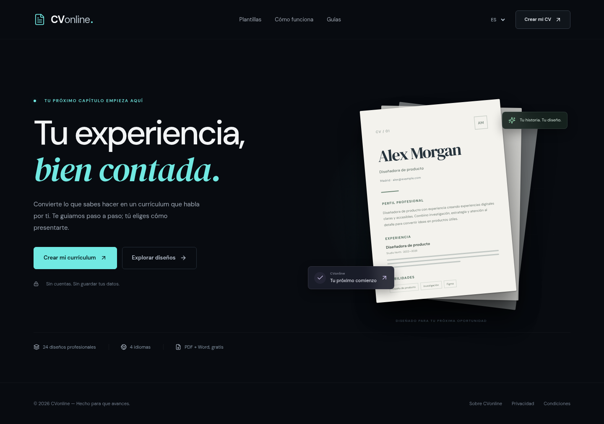

# CVonline

CVonline ayuda a crear un currículum mediante preguntas guiadas, elegir un diseño y descargarlo en PDF o Word. La interfaz es oscura, adaptable a móvil y disponible en español, inglés, italiano y portugués. No requiere cuentas ni un servidor de datos personales.



El recorrido utiliza pantallas independientes: **portada → idioma → tipo de CV → diseño → perfil → preguntas → revisión → descarga**. Las preguntas cubren datos de contacto, experiencia, formación, proyectos, habilidades, idiomas, certificaciones y presentación profesional. El usuario puede volver a sus respuestas antes de descargar.

## Funciones

- 400 diseños originales, 50 para cada uno de ocho enfoques: Harvard, cronológico inverso, funcional, mixto, académico, europeo, técnico y creativo. La elección del tipo precede al diseño y cambia el orden real de las secciones en la vista previa, PDF y Word.
- Foto opcional, procesada en el navegador, sin subirla a un servidor.
- Personalización de color, tamaño del texto y papel A4 o Carta.
- Seis tipografías adicionales alojadas localmente: Inter, Lato, Montserrat, Source Sans 3, Source Serif 4 y Merriweather. Se incrustan en el PDF; Word utiliza la familia seleccionada si está instalada y puede sustituirla en otro equipo.
- PDF con texto seleccionable y documentos de varias páginas cuando el contenido lo requiere.
- Word editable: conserva el contenido y adapta el diseño a una columna para facilitar la edición. No reproduce exactamente las composiciones de dos columnas del PDF.
- Cuatro idiomas para preguntas, interfaz, guías y títulos del documento; traducción del contenido descriptivo en el dispositivo, sujeta a disponibilidad del navegador y descarga de modelos.
- Seis guías originales por idioma, además de las páginas de información, privacidad y condiciones.

Las respuestas y la foto solo permanecen en la memoria de la pestaña. **Recargar o cerrar elimina el trabajo.** No hay recuperación de sesiones. La descarga se guarda en el dispositivo donde el usuario decida.

Consulta [las tipografías y sus licencias](docs/FONTS.md).

## Desarrollo local

Requisitos: Node.js 24, npm y acceso al registro de paquetes. El repositorio contiene el archivo de bloqueo `package-lock.json`; utilízalo para instalaciones repetibles. Cada tarea en la nube ya tiene un entorno aislado: trabaja en este checkout existente; no crees un worktree salvo que el usuario lo solicite.

```bash
cd /workspace/CVonline
ONNXRUNTIME_NODE_INSTALL_CUDA=skip npm ci
npm run dev
```

El servidor de desarrollo escucha en `0.0.0.0`; Vite muestra el puerto disponible, normalmente `5173`. En otro sistema, sustituye la ruta del ejemplo por la de tu checkout. En PowerShell, configura primero `$env:ONNXRUNTIME_NODE_INSTALL_CUDA = 'skip'` y ejecuta `npm ci`.

`ONNXRUNTIME_NODE_INSTALL_CUDA=skip` es una opción del instalador de ONNX Runtime que evita descargar los componentes CUDA, innecesarios para esta web. La traducción usa WebAssembly en el navegador. No se deshabilitan verificaciones TLS ni de integridad. No uses `npm install` para una preparación rutinaria: puede cambiar el archivo de bloqueo.

```bash
npm run typecheck
npm run build
npm run preview
```

`npm run build` comprueba TypeScript, prepara los recursos WebAssembly desde la dependencia instalada, genera la aplicación y prerenderiza 52 páginas públicas en `dist/`. El binario se distribuye comprimido en gzip, con una comprobación de igualdad byte a byte; el navegador lo descomprime en memoria mediante `DecompressionStream` y lo entrega a la opción oficial `wasmBinary` de ONNX Runtime. Las pantallas con datos del usuario continúan funcionando en el navegador. `npm run preview` sirve el resultado compilado; no sustituye una comprobación en el alojamiento final.

## Pruebas

Las pruebas de navegador utilizan Playwright. Antes de ejecutarlas, instala Chromium y sus dependencias en una máquina compatible:

```bash
npx playwright install --with-deps chromium
# Linux: instalar poppler-utils para comprobar el texto y las páginas del PDF.
npm run build
npm test
```

`npm test` comprueba la versión de producción compilada. En Linux, las pruebas de PDF requieren `poppler-utils` (`pdftotext`, `pdfinfo` y `pdfimages`); en macOS, instala Poppler con el gestor de paquetes de tu sistema. `PLAYWRIGHT_CHROMIUM_EXECUTABLE` permite indicar un Chromium existente. `npm run test:ui` abre el modo interactivo. Si el entorno no permite instalar dependencias del sistema, utiliza su navegador de pruebas ya disponible o solicita los permisos correspondientes. La comprobación del recorrido no sustituye revisar los documentos exportados y realizar una traducción real en los dispositivos de destino.

## Configuración pública

La aplicación puede ejecutarse sin variables. Para configurar la publicación, copia `.env.example` a `.env.local` o define los campos equivalentes en Cloudflare. Los valores `VITE_*` se incluyen en los archivos públicos: **no son secretos**. No pongas tokens, claves privadas ni credenciales en ellos.

| Variable | Uso |
| --- | --- |
| `VITE_SITE_URL` | Origen HTTPS real publicado, sin ruta. Genera las URL canónicas, alternativas por idioma y `sitemap.xml`. Déjala vacía mientras no exista una dirección definitiva. |
| `VITE_OPERATOR_NAME` | Nombre real del responsable de la web, mostrado en las páginas informativas. Completar antes de publicar. |
| `VITE_CONTACT_EMAIL` | Correo público real de contacto. Completar antes de publicar. |
| `VITE_ADSENSE_CLIENT` | Identificador público asignado por AdSense. La compilación usa por defecto el ID real del fragmento en `index.html`; esta variable permite sustituirlo. Genera el script, el meta y `ads.txt`. |
| `VITE_GOOGLE_SITE_VERIFICATION` | Valor público `content` de la etiqueta HTML proporcionada por Search Console para verificar la propiedad Prefijo de URL. |
| `VITE_ADSENSE_READY` | Controla el componente opcional de preferencias de publicidad. No impide la carga del script estático de verificación en las páginas públicas. |

Los cambios de estas variables requieren una nueva compilación. Consulta [tipos y fuentes de diseño](docs/CV_TYPES.md), [despliegue en Cloudflare](docs/CLOUDFLARE.md) y [tratamiento de datos](docs/PRIVACY.md).

## Traducción local

Cuando está disponible, se utiliza la implementación local de la API Translator de Google Chrome. El respaldo utiliza Transformers.js y modelos Marian ejecutados en un Web Worker con WebAssembly. No existe un endpoint de traducción al que se envíe el currículum.

El respaldo descarga archivos públicos desde Hugging Face: aproximadamente **108 MiB de pesos por dirección**, además de tokenizadores y runtime. Entre español, italiano y portugués se utiliza el inglés como idioma intermedio, por lo que se necesitan unos **216 MiB de pesos**. Es una operación exigente para conexiones móviles y dispositivos con poca memoria. Los modelos del respaldo no se guardan en almacenamiento persistente por la aplicación; puede ser necesario descargarlos en cada uso. El navegador administra los recursos de su propia API nativa.

La traducción está implementada, pero **la inferencia completa del respaldo no pudo validarse en el entorno de desarrollo porque el CDN de modelos devolvió HTTP 403**. Debe probarse con acceso a esos archivos y en navegadores de destino antes de presentarla como función verificada. Si falla, las respuestas originales se conservan y el usuario puede redactar directamente en el idioma deseado. Nombres propios y datos de contacto no se traducen; los términos profesionales siempre requieren revisión.

## Estructura

```text
src/
  App.tsx                 Rutas y navegación
  Wizard.tsx              Preguntas guiadas
  CvTypePage.tsx           Tipo de CV y orientación
  cv-types.ts              Los ocho enfoques y textos por idioma
  TemplatesPage.tsx        Catálogo de diseños por tipo
  Review.tsx              Revisión y descargas
  ResumePreview.tsx        Vista previa
  templates.ts            Los 400 diseños originales
  exports/                Generadores PDF y DOCX
  translation*.ts         Traducción local y worker
  locales/                Textos de los cuatro idiomas
  content.ts              Guías originales
  prerender.tsx           Páginas públicas y SEO de compilación
public/
  _headers                Cabeceras para Cloudflare Pages
  _redirects              Navegación de rutas en Cloudflare Pages
  robots.txt              Exclusión de las pantallas del editor
scripts/
  copy-onnx.mjs            Compresión verificada del runtime WebAssembly instalado
docs/                     Publicación y privacidad
```

## Publicación y monetización

El código permanece en GitHub y la web está desplegada en Cloudflare Pages: **https://cvonline-zw0.pages.dev**. Cloudflare confirmó el despliegue de producción; el entorno de desarrollo recibe HTTP 403 al intentar acceder al dominio público, por lo que esa comprobación externa sigue pendiente. Un dominio propio puede conectarse después sin cambiar de repositorio.

`index.html` contiene el fragmento de AdSense solicitado por el propietario, con ID `ca-pub-7507181626477156`. La compilación lo incluye en el `<head>` de las 52 páginas públicas, genera el meta de cuenta y `ads.txt`, y prepara `editor.html` sin ese script. Las rutas del editor se sirven mediante rewrites específicos y la entrada inicial abre un documento limpio antes de solicitar datos personales.

La carga del script público es independiente de `VITE_ADSENSE_READY`. Google puede tratar metadatos y cookies; la aprobación, los anuncios automáticos y el consentimiento dependen de la configuración real de la cuenta. El propietario gestiona esos ajustes y la CMP certificada cuando corresponda. El cuadro de elección incluido no sustituye una CMP ni bloquea el script estático. No se garantiza aprobación ni ingresos.

## Derechos y dependencias

El código, diseños y contenido originales de CVonline tienen los derechos reservados indicados en [LICENSE](LICENSE). Esto no cambia las licencias de sus dependencias. React, los generadores de documentos, las fuentes, iconos, runtime y modelos mantienen sus licencias respectivas; consulta [THIRD_PARTY_NOTICES.md](THIRD_PARTY_NOTICES.md).
